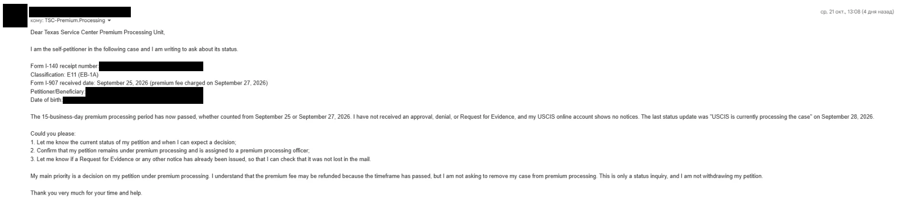
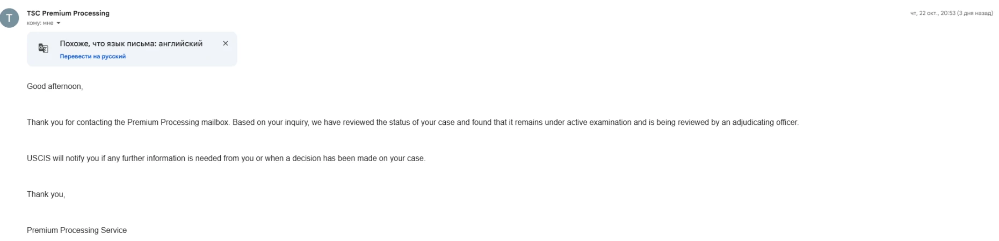

# Process Timeline

[← Back to overview](../README.md)

This is a chronological record of my EB-1A case.
Each entry is based on a USCIS notice, my USCIS online account, or another record I have on hand.
Entries are added only after the event has happened.

## Stages

| Stage | Status |
|---|---|
| Preparation, evidence and petition assembly | Completed before filing; not yet documented here |
| Filing: I-140 with concurrent I-907 | [September 27, 2026](#september-27-2026--i-140-and-i-907-filed) |
| Receipt | Receipt email: [September 28, 2026](#september-28-2026--premium-processing-receipt-email); Form I-797 pending |
| USCIS action on the I-140 | Pending; status inquiry [October 21, 2026](#october-21-2026--status-inquiry-to-premium-processing), reply [October 22, 2026](#october-22-2026--reply-from-premium-processing) |
| After the I-140 decision | Not started |

## Timeline

### September 27, 2026 — I-140 and I-907 filed

I filed Form I-140, Immigrant Petition for Alien Workers, as a self-petition under the EB-1A extraordinary ability classification.
At the same time, I filed Form I-907, Request for Premium Processing Service.
Both forms were submitted through my USCIS online account.

The same day, the account listed the I-140 case with the I-907 shown as concurrently filed.
It showed the status "Your form is still being processed".
According to the account, USCIS issues a receipt notice if the form is accepted.
No receipt notice had been received at the time of this entry.

**Status:** Your form is still being processed 
**Source:** USCIS online account, September 27, 2026

*USCIS online account, September 27, 2026. Cropped to the case card.*

### September 28, 2026 — Premium Processing receipt email

USCIS sent an automated Premium Processing email stating that the Texas Service Center had received the I-140 petition, classification sought E11 (the USCIS code for EB-1A).
The email included a receipt number.

According to the email, the Form I-797 receipt notice will follow by mail, and the Texas Service Center will "adjudicate this case within 15 business days" of the received date.

The email lists September 25, 2026 as the date Form I-907 was received.
This differs from the filing date: I submitted and paid for both forms on September 27, 2026, and the USCIS online account also shows September 27.
The Form I-797 receipt notice will show the official received date.

**Status:** I-140 received by the Texas Service Center 
**Source:** USCIS email, September 28, 2026

*USCIS email, September 28, 2026. Receipt number, names and date of birth redacted.*

### October 21, 2026 — Status inquiry to Premium Processing

By my count, the 15-business-day Premium Processing period ended on October 19, 2026.
The date is the same whether counted from September 25 (the I-907 received date in the USCIS email) or from September 27 (the filing date), with weekends and the October 12 federal holiday excluded.
No approval, denial or Request for Evidence had arrived by then.
My USCIS online account showed no notices; its last status update was "USCIS is currently processing the case", dated September 28, 2026.

On October 21, 2026, I emailed the Texas Service Center Premium Processing mailbox and asked USCIS to:

1. Tell me the current status of the petition and when to expect a decision.
2. Confirm that the petition remains under premium processing and is assigned to an officer.
3. Tell me whether a Request for Evidence or any other notice had already been issued, in case it was lost in the mail.

I stated that this was only a status inquiry.
I did not ask to remove the case from premium processing or to withdraw the petition.

**Status:** No decision or notice received 
**Source:** My email to the Texas Service Center Premium Processing mailbox, October 21, 2026

*My email to the TSC Premium Processing mailbox, October 21, 2026. Sender, receipt number, name and date of birth redacted.*

### October 22, 2026 — Reply from Premium Processing

The Premium Processing mailbox replied the next day.
According to the reply, the case "remains under active examination and is being reviewed by an adjudicating officer".
USCIS will notify me if it needs more information or when a decision has been made.

The reply did not give an expected decision date and did not mention the premium processing fee.

**Status:** Under active examination by an adjudicating officer 
**Source:** TSC Premium Processing email, October 22, 2026

*TSC Premium Processing email, October 22, 2026. Cropped. The Russian text is the Gmail interface.*

---

## Notes on This Page

- Dates are the dates shown on USCIS notices or in the USCIS online account.
- Statuses are quoted as USCIS shows them. They are not interpreted beyond what the notice says.
- Screenshots are cropped or permanently redacted. Receipt numbers, account numbers and other personal identifiers are removed.
- Media files are named `YYYY-MM-DD_short-description.ext` and stored in [`media/`](media/).
