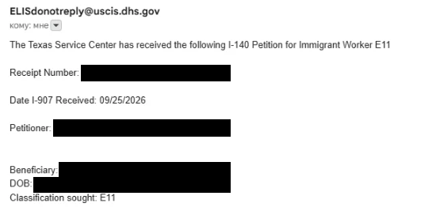

# Process Timeline

[← Back to overview](../README.md)

This is a chronological record of my EB-1A case.
Each entry is based on a USCIS notice, my USCIS online account, or another record I have on hand.
Entries are added only after the event has happened.

## Stages

| Stage | Status |
|---|---|
| Preparation, evidence and petition assembly | Completed before filing; not yet documented here |
| Filing: I-140 with concurrent I-907 | [September 27, 2026](#september-27-2026--i-140-and-i-907-filed) |
| Receipt | Receipt email: [September 28, 2026](#september-28-2026--premium-processing-receipt-email); Form I-797 pending |
| USCIS action on the I-140 | Pending |
| After the I-140 decision | Not started |

## Timeline

### September 27, 2026 — I-140 and I-907 filed

I filed Form I-140, Immigrant Petition for Alien Workers, as a self-petition under the EB-1A extraordinary ability classification.
At the same time, I filed Form I-907, Request for Premium Processing Service.
Both forms were submitted through my USCIS online account.

The same day, the account listed the I-140 case with the I-907 shown as concurrently filed.
It showed the status "Your form is still being processed".
According to the account, USCIS issues a receipt notice if the form is accepted.
No receipt notice had been received at the time of this entry.

**Status:** Your form is still being processed 
**Source:** USCIS online account, September 27, 2026

*USCIS online account, September 27, 2026. Cropped to the case card.*

### September 28, 2026 — Premium Processing receipt email

USCIS sent an automated Premium Processing email stating that the Texas Service Center had received the I-140 petition, classification sought E11 (the USCIS code for EB-1A).
The email included a receipt number.

According to the email, the Form I-797 receipt notice will follow by mail, and the Texas Service Center will "adjudicate this case within 15 business days" of the received date.

The email lists September 25, 2026 as the date Form I-907 was received.
This differs from the filing date: I submitted and paid for both forms on September 27, 2026, and the USCIS online account also shows September 27.
The Form I-797 receipt notice will show the official received date.

**Status:** I-140 received by the Texas Service Center 
**Source:** USCIS email, September 28, 2026

*USCIS email, September 28, 2026. Receipt number, names and date of birth redacted.*

---

## Notes on This Page

- Dates are the dates shown on USCIS notices or in the USCIS online account.
- Statuses are quoted as USCIS shows them. They are not interpreted beyond what the notice says.
- Screenshots are cropped or permanently redacted. Receipt numbers, account numbers and other personal identifiers are removed.
- Media files are named `YYYY-MM-DD_short-description.ext` and stored in [`media/`](media/).
