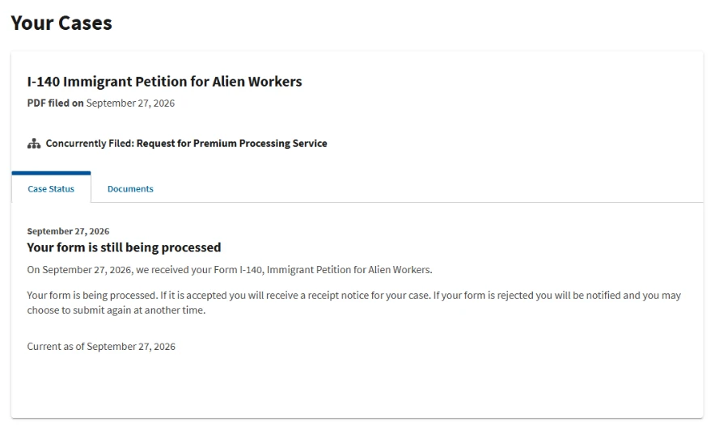

# Process Timeline

[← Back to overview](../README.md)

This is a chronological record of my EB-1A case.
Each entry is based on a USCIS notice, my USCIS online account, or another record I have on hand.
Entries are added only after the event has happened.

## Stages

| Stage | Status |
|---|---|
| Preparation, evidence and petition assembly | Completed before filing; not yet documented here |
| Filing: I-140 with concurrent I-907 | [September 27, 2026](#september-27-2026--i-140-and-i-907-filed) |
| Receipt notice | Pending |
| USCIS action on the I-140 | Pending |
| After the I-140 decision | Not started |

## Timeline

### September 27, 2026 — I-140 and I-907 filed

I filed Form I-140, Immigrant Petition for Alien Workers, as a self-petition under the EB-1A extraordinary ability classification.
At the same time, I filed Form I-907, Request for Premium Processing Service.
Both forms were submitted through my USCIS online account.

The same day, the account listed the I-140 case with the I-907 shown as concurrently filed.
It showed the status "Your form is still being processed".
According to the account, USCIS issues a receipt notice if the form is accepted.
No receipt notice had been received at the time of this entry.

**Status:** Your form is still being processed 
**Source:** USCIS online account, September 27, 2026

*USCIS online account, September 27, 2026. Cropped to the case card.*

---

## Notes on This Page

- Dates are the dates shown on USCIS notices or in the USCIS online account.
- Statuses are quoted as USCIS shows them. They are not interpreted beyond what the notice says.
- Screenshots are cropped or permanently redacted. Receipt numbers, account numbers and other personal identifiers are removed.
- Media files are named `YYYY-MM-DD_short-description.ext` and stored in [`media/`](media/).
